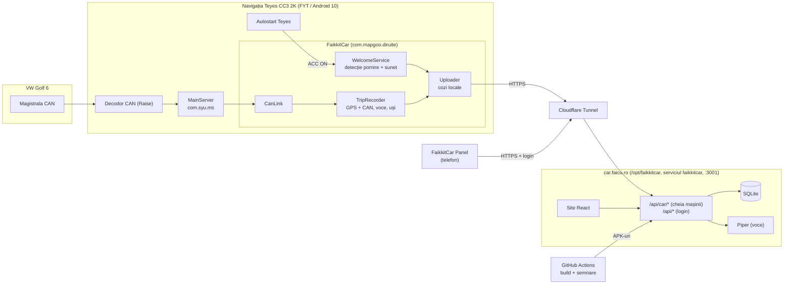

# FaikkitCar

„Calculator de bord” conectat pentru **VW Golf 6** (1.2 TSI CBZB, 2012) cu navigația
**Teyes CC3 2K**. Trei părți:

| Parte | Ce e | Unde |
|---|---|---|
| **FaikkitCar** (`app/`) | Aplicația din mașină: sunetul de bun venit, călătoriile (GPS + datele mașinii), vocea în mers, jurnalul | Navigația Teyes, pachet `com.mapgoo.diruite` |
| **car.faicu.ro** (`web/`) | Serverul și site-ul: poziția mașinii, călătorii cu hartă și grafic, consum și cost, alimentări, mentenanță, service, jurnal | Serverul de acasă, `/opt/faikkitcar`, serviciul `faikkitcar` |
| **FaikkitCar Panel** (`panel/`) | Aplicația de telefon, nativă, cu aceleași date ca site-ul | Telefonul, pachet `ro.faicu.faikkitcar.panel` |

| | |
|---|---|
| **Versiuni** | FaikkitCar 1.1.62 (`build-62`) · FaikkitCar Panel 1.0.24 (`panel-24`) |
| **Descărcare** | Mașina: [FaikkitCar.apk](https://github.com/Faicu/FaikkitCar/releases/latest/download/FaikkitCar.apk) sau din aplicație, „Actualizează acum” · Telefonul: car.faicu.ro → Mai mult, „Descarcă APK” |
| **Site** | https://car.faicu.ro (login în `/opt/faikkitcar/.env`) |
| **Repo** | `Faicu/FaikkitCar` (privat) |
| **Actualizat** | 22.10.2026 |

Istoricul (versiuni, constatări datate, migrarea din FaikkitBox) e în [`ISTORIC.md`](ISTORIC.md);
detaliile tehnice pentru dezvoltare în [`CLAUDE.md`](CLAUDE.md).

**Legendă:** ✅ confirmat în uz real · 🧪 construit, netestat în uz real · 🔍 în lucru ·
💡 idee / neînceput

---

## Unde suntem

- ✅ **Aplicația rezistă pe navigație:** trece prin somnul de peste noapte, iar când e omorâtă
  (lipsă de memorie), „Acces la notificări” o repornește în câteva secunde.
- 🔍 **De urmărit:** cât de des moare procesul imediat după plecare și cine o repornește după
  o moarte în somnul lung.
- ✅ Datele mașinii, călătoriile, salutul vorbit, actualizarea din aplicație, alimentările,
  jurnalul de service și Panel-ul merg.
- ✅ **Consumul real** se ia din plinuri (plin → plin); indicatorul rezervorului nu e liniar
  la capete.
- 🧪 Netestate încă în mașină: avertizarea de ușă deschisă, contactul pus cu motorul oprit,
  harta live pe drum.

## Ce urmează

1. **Instalează FaikkitCar 1.1.66** în mașină (Setări → actualizare); sunetul de bun venit nu se mai dublează. Semnalul mobil al
   cartelei Digi pe fiecare punct de traseu. După câteva drumuri, fila Navigație → „Semnal
   mobil” arată pe hartă unde cade internetul și pe ce bandă. Benzile Teyes (B1, B3, B7, B8,
   B20, B28A, B38…) le acoperă pe toate cele din România; Digi are puțin pe 800/900 MHz
   (5 + 3 MHz), deci în afara orașelor pierde primul. Apoi, de comparat cu o cartelă Orange
   preplătită pe aceleași drumuri.
2. **Instalează Panel 1.0.26** (semnalul mobil pe fila Navigație; „Actualizează acum”, o singură apăsare,
   apoi confirmarea; ~30 s până pornește versiunea nouă).
3. **Performanța navigației:** pe Acum, rândul „Navigația” spune pe scurt dacă e totul în
   regulă; fila Navigație are graficele și procesele. De văzut pe drum dacă memoria liberă
   scade înainte ca aplicația să fie omorâtă. Radio-ul Teyes (`sqlfmserver`) rămâne pornit după
   închidere și ține ocupat un nucleu întreg; se oprește abia la repornirea navigației.
4. **La următoarea oprire de peste 20 min**, jurnalul arată dacă aplicația a supraviețuit
   somnului („trezire din hibernare”) sau cine a repornit-o („Acces la notificari: sistemul
   ne-a pornit”, „Alarma de rezerva”, „Serviciu pornit … ultima activitate”).
5. **Alimentări:** fiecare trecută pe car.faicu.ro sau în Panel, cu prețul plătit efectiv pe
   litru (după reducere). Plinurile (până se oprește pistolul) dau consumul exact.
6. 💡 **Idei:** alertă pe telefon la pornirea mașinii, ore de liniște, sunet după ora zilei,
   adaptor OBD2 pentru consum instantaneu, voce și mai naturală (Azure / ElevenLabs).

---

## Funcțiile

### Sunetul de bun venit

| Funcție | Stare | Detalii |
|---|---|---|
| Sunet la pornire după o oprire scurtă | ✅ | Prin autostart-ul Teyes („FaikkitCar Start”); la opriri scurte navigația nu doarme |
| Sunet după hibernare (opriri lungi) | ✅ | Serviciul supraviețuiește somnului și măsoară pauza |
| Pauză înainte de redare | ✅ | 5 s, plus încă ceva după o hibernare adevărată (implicit 2 s, pe mașină 3 s din Setări) |
| Începutul sunetului nu se taie | ✅ | 1,2 s de liniște înainte (ieșirea audio Teyes pornește abia cu primul sunet) |
| Anti-dublare | ✅ | Autostart și pauza detectată în același timp dau o singură redare (fereastră de 20 s) |
| Mai multe sunete, la rând sau aleatoriu, volum propriu | ✅ | Din lista proprie de fișiere audio (navigația nu are selector de fișiere) |
| Deschiderea aplicației nu redă sunetul | ✅ | |

### Aplicația din mașină

| Funcție | Stare | Detalii |
|---|---|---|
| Interfață | ✅ | Temă întunecată, bara compactă jos: Acasă / Sunete / Setări / Jurnal |
| Acasă: harta și ce nu arată bordul | 🧪 | Harta mare (călătoria în curs sau ultima, mașina pe ea), alături viteza, starea („Oprit in trafic · 45 s”, „Parcat, motor pornit”…), costul / litrii / traficul drumului, ziua de azi, bateria doar în afara limitelor, actualizarea și mentenanța scadentă |
| Jurnal trimis live la server | ✅ | Coadă locală (2.000 de linii); la orice eroare a serverului datele rămân în coadă. Căderile aplicației apar cu eroarea exactă |
| Actualizare din aplicație | ✅ | CI-ul publică APK-ul pe car.faicu.ro, aplicația îl descarcă și îl instalează; cât se instalează, butonul arată „Se instalează...” |
| Ținută în viață | ✅ | Vezi [Ținerea în viață](#ținerea-în-viață-a-aplicației) |
| Resurse puține în fundal | 🧪 | Harta și ecranul lucrează doar cât aplicația e deschisă; în fundal rămâne serviciul. Vocea locală se eliberează la 30 s după ce vorbește |
| Linia „Teyes” în jurnal | 🧪 | La fiecare pornire a serviciului: listele Teyes, accesul la notificări, memoria liberă |
| Comenzi de la distanță (teste) | 🧪 | Setări → Sistem, oprit implicit: serverul poate rula comenzi pe navigație (fără root); rezultatele sunt în jurnalul „Comenzi la distanță” |
| Sonda CAN | ✅ | Setări → „avansat”: 10 minute, marcaje cu text, schimbările live |

### Datele mașinii, călătoriile și consumul

| Funcție | Stare | Detalii |
|---|---|---|
| Datele CAN prin MainServer | ✅ | Vezi [Datele mașinii](#datele-mașinii-can) |
| Înregistrarea călătoriilor | ✅ | Punct la 5 s în mers, 30 s pe loc cu motorul pornit, nimic cu motorul oprit |
| GPS oprit cu motorul oprit | ✅ | După 1 min cu turația 0; pornit din nou la turație sau mers |
| Drumuri neînregistrate | 🧪 | Kilometrajul sare cu ≥ 2 km între două călătorii → „Drum neînregistrat” în listă, cu km, litrii și costul estimate |
| Nivelul combustibilului | ✅ | c104, în litri; cu motorul oprit decodorul trimite 0 (ignorat) |
| Consum și cost pe călătorie | 🧪 | Estimare din model fizic, calibrată din plinuri (altfel din nivelul rezervorului); costul cu prețul ultimei alimentări |
| Alimentări | ✅ | Pe site și în Panel; kilometrajul se completează automat |
| Mentenanță după km / dată (ulei, ITP, RCA, rovinietă, distribuție) | 🧪 | Se editează pe site sau în Panel; cele scadente apar pe navigație și în salut |
| Salut vorbit după 30 s de mers | ✅ | Ora zilei, temperatura de afară, mentenanța scadentă. Vocea Piper „Mihai” de pe server; fără internet, vocea Google |
| Avertizare „ușă deschisă” în mers (≥ 5 km/h) | 🧪 | Vocea locală (fără întârziere) sau bip |

### Site-ul car.faicu.ro și FaikkitCar Panel

La fel pe site și în Panel, în cinci file: **Acum · Călătorii · Costuri · Navigație · Mai mult**.

| Funcție | Stare | Detalii |
|---|---|---|
| Login | ✅ | Site: cookie de 180 de zile. Panel: token păstrat în aplicație |
| Acum: starea mașinii | ✅ | Oprită / Doar contact / Motor pornit / În mers, de când; viteză, turație, baterie; actualizată la 5 s cu motorul pornit |
| Acum: „Fără semnal” | 🧪 | Dacă mașina tace după mers sau motor pornit, „Fără semnal” de la ultima stare, cu drumul în curs până acolo; după o oră, „Oprită” |
| Acum: climă și detalii | ✅ | AC, AUTO, ventilator, temperaturile setate stânga / dreapta, afară; uși, centură, frâna de mână, marșarier |
| Acum: călătoria în curs | 🧪 | Distanță, durată, litri, L/100, cost și harta live (plecarea, traseul, mașina, opririle; „Urmărește mașina”) |
| Acum: rezervor și autonomie | 🧪 | Litrii de la mașină ÷ consumul mediu real |
| Acum: navigația pe scurt | ✅ | Un rând în primul card: „merge bine · 1,1 GB liberi · procesor 24% · 48 °C” sau problemele (memorie sub 600 / 300 MB, swap plin, peste 70 / 80 °C, procesorul peste 75% în medie pe 3 min, un proces care ține ocupat un nucleu, sub 1 GB spațiu); atins, duce la fila Navigație |
| Navigație: semnal mobil | 🧪 | Harta pe pătrate de ~200 m (verde = semnal bun … roșu = fără internet), partea din timpul de drum fără internet, benzile LTE folosite (din canal) cu semnalul median, operatorul și căderile de internet din mers (de la 15 s), pe 7 / 30 / 90 de zile, pe site și în Panel; de la FaikkitCar 1.1.64 (primele puncte venite pe 28.10: Digi pe B8 900) |
| Navigație | ✅ | Procesorul, memoria liberă și temperatura (cu graficele pe ultima oră), swap-ul, de când e pornită, memoria și adj-ul FaikkitCar, spațiul liber și procesele care consumă cel mai mult; „doarme” când nu mai vin măsurări (confirmat pe navigație pe 22.10, prin somn și repornire) |
| Unde e mașina | ✅ | Ultima poziție GPS, pe hartă și în Google Maps |
| Propuneri | 🧪 | „Ai alimentat pe … ~16 L?” (salt în rezervor) și „Parchezi des aici: …”; „Da” completează, „Nu” ascunde |
| Călătoriile | ✅ | Listă (cu drumurile neînregistrate; pornirile pe loc sub 0,5 km ascunse) și detalii: traseul, distanța, durata, costul, bara timpului (mers / trafic / staționare / motor oprit), harta, grafice viteză / turație / rezervor |
| Opriri în trafic vs. staționare | 🧪 | Vezi [Cum se calculează o călătorie](#cum-se-calculează-o-călătorie) |
| Combinarea călătoriilor | 🧪 | „Combină cu precedenta / următoarea”, „Desparte”; opririle dintre părți apar pe hartă ca puncte galbene |
| Costuri: 30 de zile, pe luni, raportul lunii | 🧪 | km, timp, trafic, litri, L/100, cost estimat și ce s-a dat la pompă; staționarea cu motorul pornit (timp, litri, lei); cea mai lungă călătorie, locurile cele mai dese |
| La serviciu (ture 12/24) | 🧪 | Următoarea tură (zi 08–20, noapte 20–08, liber, liber, dedus din drumuri) și ora până la care să pleci ca să ajungi cu 15 min înainte (drumul din zilele proaste, percentila 90) |
| Drumurile tale | 🧪 | Între locuri salvate, de la 10 deplasări în 90 de zile: costul, durata medie fără staționări, timpul în trafic |
| Locuri salvate (Acasă, Serviciu...) | 🧪 | Călătoriile apar „Acasă → Serviciu”. Loc nou după adresă, cu pinul mutat pe hartă și raza, sau „Salvează sosirea ca loc”. Un loc poate avea mai multe poziții (ex. două parcări acasă): „+ Poziție” pe rândul lui (site, Panel 1.0.25) |
| Jurnal de service | ✅ | Lucrările cu data, kilometrajul, locul, costul, articolele pe grupe și bonurile / facturile atașate; costul intră în raportul lunii |
| Jurnalul navigației | ✅ | Pe bucăți: Evenimente, Pornire și somn, Mașina, GPS, Sunet și voce, Actualizări, CAN și diagnostic, Comenzi la distanță, Tot. Nu se poate goli |
| Panel: actualizare din aplicație | ✅ | „Actualizează acum” |

---

## Arhitectura



---

## Cum detectează pornirea mașinii

| Situație | Ce face Teyes | Ce prinde pornirea |
|---|---|---|
| Oprire scurtă (sub ~10 min) | Doar stinge ecranul; procesorul merge mai departe | **Autostart-ul Teyes**, care lansează „FaikkitCar Start” la ACC ON |
| Oprire lungă | Intră în somn la ~10 min după ACC OFF | **Pauza măsurată de serviciu**; de obicei vine și autostart-ul |
| Boot complet (după ~72 h sau reporniri periodice) | Pornește de la zero | **Contorul de boot-uri** Android |

Autostart-ul Teyes ratează uneori; detecția prin pauză acoperă cazurile cu somn. Ceasul
navigației poate sări câteva secunde la trezire, deci ordinea liniilor din jurnal poate părea
inversată atunci.

## Ținerea în viață a aplicației

| Ce se întâmplă | Ce ne repornește | Cât durează |
|---|---|---|
| Procesul e omorât (memorie, kill) | Sistemul repornește serviciul permanent; „Acces la notificări” | ~1 s cu navigația trează, ~7 s prin „Acces la notificări” în mers |
| Oprire forțată (force-stop) | „Acces la notificări”: sistemul se leagă din nou de aplicație | Emulator: imediat; pe navigație netestat |
| Omorât în somn | Alarma de rezervă (nu trezește navigația) | La prima trezire, cel mult ~1 min |
| ACC ON după o oprire scurtă | Autostart-ul Teyes („FaikkitCar Start”) | Imediat |
| Boot complet / actualizare | `BootReceiver` | La pornire |
| Teyes închide aplicațiile la somn | Numele `com.mapgoo.diruite`, pe listele albe Teyes | Nu suntem închiși |

Prioritatea procesului rămâne 200 pe navigație (Teyes își dă −700); cu „Acces la notificări”
ar trebui să fie 100 (așa e în emulator), dar ROM-ul Teyes nu o schimbă.

---

## Ce știm despre Teyes CC3 2K

| Aspect | Constatare |
|---|---|
| Platforma | FYT/SYU pe Unisoc UMS512 (`sprd ums512_1h10_Natv`), Android 10 |
| Închiderea aplicațiilor | La somn, MainServer (`com.syu.ms`) oprește forțat tot ce nu e în `unkill_app.txt` (din APK-ul lui), `skipkillapp.prop` sau `protected_app.txt` |
| Autostart | `/oem/app/pwctl_config.xml` („LaunchWhiteList”) decide cine are voie să pornească automat |
| Soluția | Aplicația poartă numele `com.mapgoo.diruite`, prezent pe ambele liste și neinstalat pe navigație. Merge fără root |
| Ieșirea audio | Pornește abia când începe un sunet (~0,5 s pierdute), oricât s-ar aștepta înainte |
| Voce | Google TTS cu o singură voce română (`vfv`, locală și online, la fel de robotice); cea online întârzie ~3 s |
| Lipsuri | Nu are selector de fișiere Android (nici `OPEN_DOCUMENT`, nici `GET_CONTENT`); „Car Info” nu afișează litrii |
| Memoria | 4 GB, swap 2,2 GB. Cu tapet static și Google, TXZ, Google Maps, YouTube, Bunăstare, Chrome, Android Auto dezactivate: ~1,1–1,7 GB disponibili. Restul aplicațiilor Teyes (gesturi, actualizări, Spotify Teyes, butoane) cer ADB prin cablu USB-A–A |
| Modemul 4G | FDD B1, B2, B3, B5, B7, B8, B20, B28A; TDD B34, B38, B39, B40, B41 (fișa produsului). Acoperă toate benzile 4G din România, în afară de B32 (1500 MHz, doar suplimentară, Orange). Cartela: Digi (226 05) |
| Opțiunile pentru dezvoltatori | Codul: 681232. ADB merge doar prin USB (fără port de rețea) |
| Datele mașinii | MainServer le distribuie prin AIDL-ul `com.syu.ipc`, fără permisiuni (vezi `Syu.java`) |

## Datele mașinii (CAN)

Decodor Raise, firmware `VW-RZ-08-0036.212.03-HSE`. Modul 7 = CANBUS, modul 0 = principal.
Codurile renunțate sunt în [`ISTORIC.md`](ISTORIC.md#coduri-can-renunțate).

| Cod | Ce e | Exemplu |
|---|---|---|
| m7 c110 (= c1032) | Turația | 635–750 rpm la relanti |
| m7 c1031 / c109 | Viteza (km/h / ×100) | 31 / 3171 |
| m7 c105 | Tensiunea bateriei (×100) | 13,9–14,55 V cu motorul pornit |
| m7 c106 | Kilometrajul | 245.075 km |
| m7 c139 | Temperatura exterioară (×10) | 190 = 19,0 °C |
| m7 c104 | Litrii din rezervor; 0 cu motorul oprit | oscilează cu 1 L |
| m7 c1 … c5 | Ușa șoferului, pasager față, spate stânga, spate dreapta, portbagaj | 1 = deschis |
| m7 c101 | Centura șoferului desfăcută | 1 = desfăcută |
| m7 c103 | Frâna de mână (sursa principală; „eliberată” contează doar după o mișcare de la pornirea navigației) | 1 = eliberată, 0 = trasă |
| m7 raw 0x24, bitul 0x02 | Frâna de mână trasă | 6 = trasă, 4 = eliberată |
| m0 c68 | Marșarierul | [1, 1] = băgat |
| m7 c21, c27/c28, c11, c49 | Clima: ventilatorul (0 = climatronic oprit), temperatura stânga/dreapta = 17,5 + v/2 °C, AC, AUTO | 3, 11 (= 23 °C), 1, 1 |
| m7 raw 0x41/2 | Cadrul de bord: turație, viteză, tensiune, temperatură, kilometraj, litri | |
| m7 c1019 | Cadrele brute ale decodorului (protocol Raise, antet 0x2E) | clima, radar, uși, volan, date de bord |
| m0 c179 | Poziția GPS a unității | lon, lat, alt |
| m7 c107 | Neclar (stă pe 1) | |
| — | Pedala de frână, semnalizarea, avariile, ștergătoarele, temperatura din habitaclu, consumul | nu sunt transmise de decodor |

---

## Cum se calculează o călătorie

Pe server (`web/server/trip-math.ts`), segment cu segment, din punctele trimise de mașină:

- **Distanța:** din GPS cât timp are semnal bun; fără GPS (tunel, fix întârziat), din viteză.
  Pe loc, zgomotul GPS nu se adună. Se potrivește cu kilometrajul la ±1 km.
- **Opririle cu motorul oprit** (pauză de peste 1 minut): la „Opriri”, cu loc și durată; nu
  intră în viteza medie. Peste 5 minute despart două călătorii (dacă nu le combini).
- **Opririle cu motorul pornit:** între două porțiuni de mers și sub 5 minute = **în trafic**;
  la plecare, la sosire, mai lungi sau cu semne de parcare (frâna de mână trasă, o ușă
  deschisă, marșarierul, un loc salvat) = **staționare**.
- **Viteza medie** e pe tot drumul fără opririle cu motorul oprit; **viteza în mișcare** doar
  pe timpul de deplasare. Mers + trafic + staționare + opriri = durata.
- **Clima și centura:** cât a mers AC-ul (intră și în consum, ~0,4 L/h) și cât ai mers fără
  centură.
- **Bateria:** „la pornire” = căderea de la demaror (sub ~9,6 V = baterie slabă); „în mers” =
  încărcarea (normal 13,5–14,9 V).
- **Locurile:** plecarea e locul unde a parcat ultima dată, chiar dacă GPS-ul prinde semnal
  abia după câteva sute de metri.

## Consumul de combustibil

- **Estimarea pe drum** (`web/server/fuel-model.ts`): model fizic al Golf-ului (accelerări,
  aer, rulare, frecările motorului, mers în gol).
- **Corecția:** estimarea e înmulțită cu raportul „real / estimat”. Realul vine întâi din
  plinuri (plin → plin, litrii de pe bonuri), altfel din nivelul rezervorului (început −
  sfârșit + alimentări, mediane pe 10 min, 90 de zile), de la ~8 L consumați. Drumurile
  neînregistrate se iau în calcul din kilometraj, ca să nu umfle corecția.
- **Rezervorul de acum** = mediana ultimelor 10 minute, doar după ultima alimentare.
- **Costul** = litrii estimați × prețul ultimei alimentări (cel plătit efectiv).
- **Mai precis** s-ar putea cu un adaptor OBD2 Bluetooth (presiune admisie + temperatură aer +
  turație), ~5% pe orice drum.

---

## Serverul `car.faicu.ro` (`web/`)

Rulează pe același server cu FaikkitBox, dar complet separat.

| | |
|---|---|
| Cod | `/opt/faikkitcar/web`: Node 22 (rulează direct TypeScript), Hono, `node:sqlite`, site React + Vite + Tailwind |
| Serviciu | systemd `faikkitcar` (`deploy/faikkitcar.service`, utilizatorul `faikkitcar`, scrie doar în `data/`) |
| Rețea | Portul 3001; Cloudflare Tunnel `car.faicu.ro` → `http://192.168.1.192:3001` |
| Config | `/opt/faikkitcar/.env` (nu e în git): `PORT`, `ADMIN_USER` / `ADMIN_PASS`, `SESSION_SECRET`, `CAR_TOKEN`, `CI_TOKEN` |
| Date | `/opt/faikkitcar/data`: `faikkitcar.db`, `apk/`, `tts/` (cache voce), `piper/` (vocea, nu e în git), `service/` (bonuri) |
| Actualizare site | `cd web && npm run build && systemctl restart faikkitcar` |

| Rută | Rol |
|---|---|
| `POST /api/car/log` | Jurnalul aplicației (păstrat integral, nu se șterge) |
| `POST /api/car/trip` | Punctele de traseu |
| `POST /api/car/state` | Starea de acum: la 5 s cu motorul pornit, 15 s doar contact, 60 s fără, imediat la o schimbare |
| `GET /api/car/summary`, `/api/car/route` | Ecranul Acasă din mașină: călătoria în curs și harta ei |
| `GET /api/car/status` | Kilometraj, mentenanță, ultimul APK, locuri |
| `GET /api/car/cmd`, `POST /api/car/cmd/<id>` | Comenzile de la distanță (doar cu opțiunea pornită în aplicație) |
| `POST /api/car/tts` | Salutul vorbit, vocea Piper „Mihai” (MP3) |
| `POST /api/car/apk`, `GET /api/car/apk[/download]` | APK-ul FaikkitCar (CI → mașina) |
| `POST /api/panel/apk`, `GET /api/panel/apk[/download]` | APK-ul Panel (CI → telefon, cu login) |
| `POST /api/login`, `/api/logout`, `/api/me` | Login pentru site și Panel |
| `/api/live`, `/api/live/route`, `/api/unit/history`, `/api/stats`, `/api/trips…`, `/api/car`, `/api/fuel`, `/api/refuels`, `/api/reminders`, `/api/places`, `/api/geocode`, `/api/suggestions`, `/api/service`, `/api/log`, `/api/cmd` | Datele pentru site și Panel (cu login) |

Rutele `/api/car/*` cer cheia mașinii (`CAR_TOKEN`), `POST /api/*/apk` cheia CI-ului
(`CI_TOKEN`); restul, login-ul.

---

## Instalare

### În mașină (FaikkitCar)

1. Instalează APK-ul. Versiunile următoare vin din aplicație: Acasă → „Actualizează acum”.
2. **Sunete:** „+ Adaugă sunete” și alegi din lista fișierelor audio de pe navigație.
3. **Setări:** dezactivează optimizarea bateriei și permite localizarea. Pauza după
   hibernare: 3 s.
4. **Autostart Teyes:** adaugă „FaikkitCar Start”.
5. **Acces la notificări:** Setări → Sistem → „Acces la notificari”; în ecranul Android,
   pornește FaikkitCar (nu citește notificările, doar ține aplicația în viață).
6. Test: Acasă → „▶ Redă acum”; Setări → „Ascultă salutul acum”.

### Pe telefon (FaikkitCar Panel)

1. Pe car.faicu.ro (logat), fila Mai mult: „Descarcă APK”.
2. Instalează (o singură dată: permite instalarea din browser) și intră cu același cont.
3. Versiunile următoare vin din aplicație („Actualizează acum”).

---

## Build, semnare și publicare

- **FaikkitCar:** `.github/workflows/build.yml`, la push (nu pentru `web/`, `deploy/`,
  `panel/`, `*.md` sau `[skip ci]`): APK semnat, release `build-N` („latest”), publicat pe
  `car.faicu.ro/api/car/apk`. Versiunea `1.1.<N>`.
- **FaikkitCar Panel:** `.github/workflows/panel.yml`, doar pentru `panel/`: release
  `panel-N`, publicat pe `car.faicu.ro/api/panel/apk`. Versiunea `1.0.<N>`.
- **Secretele repo-ului** (Settings → Secrets and variables → Actions):
  - `KEYSTORE_BASE64`, `KEYSTORE_PASSWORD`: cheia de semnare (PKCS12, alias `vwwelcome`),
    aceeași pentru ambele aplicații. **Păstrează o copie a keystore-ului.**
  - `VW_LOG_TOKEN`: cheia mașinii (intră în APK), aceeași ca `CAR_TOKEN` din `.env`.
  - `CI_TOKEN`: doar pentru publicarea APK-urilor, același ca în `.env`; nu intră în aplicație.
- **Local pe server:** JDK 17, Gradle 8.7 și Android SDK 34 în `/root/android`:
  ```
  export JAVA_HOME=/root/android/jdk
  /root/android/gradle-8.7/bin/gradle :app:assembleDebug     # sau :panel:assembleDebug
  ```
  Emulatoare (KVM): `/root/android/sdk/emulator/emulator -avd panel -no-window` (Android 14,
  cu vocea Google) și `-avd car29` (Android 10, ca navigația).

---

## Structura codului

| Folder | Conținut |
|---|---|
| `app/` | FaikkitCar, Java fără AndroidX, UI din cod (`ro.faicu.faikkitcar`; iconițele păstrează numele vechi `ro.faicu.vwwelcome.*`, pentru autostart-ul Teyes) |
| `panel/` | FaikkitCar Panel, Java fără AndroidX, UI din cod, hartă osmdroid (`ro.faicu.faikkitcar.panel`) |
| `web/server/` | API-ul: `index.ts` (rute), `auth.ts`, `db.ts`, `log.ts`, `log-category.ts`, `trips.ts`, `trip-math.ts`, `live.ts`, `car.ts`, `fuel.ts`, `fuel-model.ts`, `stats.ts`, `commute.ts`, `suggestions.ts`, `places.ts`, `service.ts`, `cmd.ts`, `apk.ts`, `tts.ts` (testele: `trip-math`, `fuel-model`, `commute`) |
| `web/src/` | Site-ul: `App.tsx` (login, file), `pages/` (`Now`, `Trips`, `Costs`, `More`, `Log`), `components/` |
| `web/scripts/` | `import-faikkitbox.ts` (migrarea), `car-cmd.ts` (comenzi pe navigație) |
| `deploy/` | `faikkitcar.service` (Remote Control: `claude.service` + `claude-rc` sunt în `/opt/faikkit/deploy`) |

Aplicația din mașină (`app/src/main/java/ro/faicu/faikkitcar/`):

| Fișier | Rol |
|---|---|
| `WelcomeService` | Serviciul permanent: detecția pornirii, tick-ul de 5 s, rețea, pornește restul |
| `Watchdog`, `KeepAliveListener` | Alarma de rezervă; „Acces la notificări” (prioritate și repornire) |
| `StartActivity`, `BootReceiver` | Intrarea invizibilă pentru autostart; pornirea la boot / actualizare |
| `Player` | Redarea sunetului (liniște de pornire, focus audio, volum, pauză) |
| `TripRecorder`, `PointQueue` | Călătoriile (GPS + CAN), salutul, avertizarea de ușă, GPS-ul econom; coada de puncte pe disc |
| `CanLink`, `CanProbe`, `Syu` | Datele mașinii din MainServer, sonda CAN, protocolul |
| `Speaker`, `Greeting` | Vocea (Piper de pe server sau TextToSpeech) și textele rostite |
| `Uploader`, `LiveState`, `VwStatus`, `Updater` | Trimiterea la server (jurnal, puncte, starea live), starea de pe server, actualizarea |
| `RouteMap` | Harta de pe Acasă (osmdroid) |
| `RemoteCmd`, `TeyesCheck` | Comenzile de la distanță, verificarea listelor Teyes |
| `UnitStats` | Performanța navigației (procesor, memorie, temperatură, procese), trimisă cu starea live |
| `CellSignal` | Semnalul mobil (tehnologia, canalul, dBm, operatorul, internetul) pe fiecare punct de traseu |
| `Prefs`, `CrashLog` | Setări și jurnal, căderile |
| `MainActivity`, `Ui` | Interfața |

Panel (`panel/src/main/java/ro/faicu/faikkitcar/panel/`): `MainActivity` (ecranele), `Api`,
`Store`, `Fmt`, `MapBox`, `ChartView`, `UnitCard`, `Updater`, `Ui`.

---

## Limitări cunoscute

- **Autostart-ul Teyes** ratează uneori; după o oprire scurtă în care ratează, nu se aude
  nimic (nu există altă cale).
- **Salutul vorbit și avertizarea de ușă** merg doar cu înregistrarea călătoriilor pornită.
- **Vocea Piper** cere internet în momentul salutului; altfel vocea Google, robotică.
- **Consumul pe drum** e o estimare (±10–15% pe un drum, exact pe sumă după corecție).
- **Pachetul `com.mapgoo.diruite`** e împrumutat de pe lista albă Teyes. Dacă un firmware nou
  schimbă lista, aplicația poate fi din nou închisă la somn (linia „Teyes” din jurnal o arată).
- **Memoria navigației** e la limită: cu YouTube Music și Waze deschise, aplicația poate fi
  omorâtă; plasele de siguranță o repornesc, dar între timp drumul nu se înregistrează.
- **Codurile CAN** sunt găsite empiric pe această mașină și pe acest decodor.
