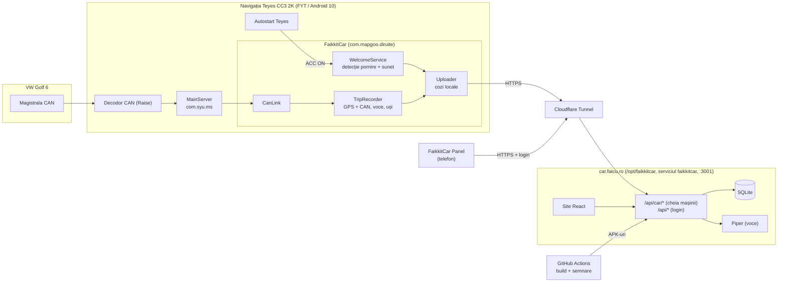

# FaikkitCar

„Calculator de bord” conectat pentru **VW Golf 6** (1.2 TSI CBZB, 2012) cu navigația
**Teyes CC3 2K**. A pornit ca „VW Welcome”, un sunet de bun venit la fiecare pornire, și
a crescut într-un proiect cu trei părți:

| Parte | Ce e | Unde |
|---|---|---|
| **FaikkitCar** (`app/`) | Aplicația din mașină: sunetul de bun venit, călătoriile (GPS + datele mașinii), vocea în mers, jurnalul | Navigația Teyes, pachet `com.mapgoo.diruite` |
| **car.faicu.ro** (`web/`) | Serverul și site-ul: poziția mașinii, călătorii cu hartă și grafic, consum și cost, alimentări, mentenanță, jurnal | Serverul de acasă, `/opt/faikkitcar`, serviciul `faikkitcar` |
| **FaikkitCar Panel** (`panel/`) | Aplicația de telefon, nativă, cu aceleași date ca site-ul | Telefonul, pachet `ro.faicu.faikkitcar.panel` |

| | |
|---|---|
| **Versiuni** | FaikkitCar 1.1.53 (`build-53`) · FaikkitCar Panel 1.0.19 (`panel-19`) |
| **Descărcare** | Mașina: [FaikkitCar.apk](https://github.com/Faicu/FaikkitCar/releases/latest/download/FaikkitCar.apk) sau din aplicație, „Actualizează acum” · Telefonul: car.faicu.ro → fila Mai mult, „Descarcă APK” |
| **Site** | https://car.faicu.ro (login în `/opt/faikkitcar/.env`) |
| **Repo** | `Faicu/FaikkitCar` (fost `welcometovw`) |
| **Actualizat** | 01.10.2026 |

**Legendă:** ✅ confirmat în uz real · 🧪 construit, netestat în uz real · 🔍 în lucru ·
💡 idee / neînceput

---

## Pe scurt: unde suntem (12.10.2026)

- 🧪 **Harta călătoriei în curs** pe site, în Panel și în mașină: de unde ai plecat, pe unde
  ai fost și unde ești acum, actualizată pe drum (1.1.46, Panel 1.0.13).
- 🧪 **Ecran nou în mașină** (1.1.47): harta mare, alături doar ce nu arată bordul (viteza,
  costul și traficul drumului, bateria doar dacă e o problemă), meniul compact jos.
- ✅ **Consumul real** verificat pe 12.10: 17 L pe 180 km = 9,4 L/100; drumurile dau 9,6.
- ✅ **Temperaturile climei** (stânga / dreapta, și cu SYNC), **centura** și **luminile**
  confirmate în mers pe 12.10.

- ✅ **Sunetul de bun venit** merge după opririle scurte (autostart Teyes) și după
  hibernare. Începutul se tăia după un somn lung; de la 1.1.28 se redă întâi 1,2 s de
  liniște, iar în jurnal redările arată „după 1200 ms de liniște”.
- ✅ **Aplicația nu mai e închisă de Teyes la somn** (poartă un nume de pe lista albă).
- ✅ **Datele mașinii** sunt identificate și confirmate: viteză, turație, tensiune,
  kilometraj, temperatură, uși, centură, frâna de mână, clima, lumini și **litrii din
  rezervor** (confirmat la alimentarea din 01.10).
- ✅ **Călătoriile** se înregistrează, iar GPS-ul se oprește singur cu motorul oprit.
- ✅ **Salutul vorbit** merge, cu vocea Piper „Mihai” de pe server (vocile Google de pe
  navigație sună robotic).
- ✅ **Actualizarea din aplicație** merge (1.1.24 → 1.1.27 → 1.1.30 → 1.1.31).
- ✅ **Contactul dedus din datele de bord** se potrivește cu realitatea pe drumurile din
  01.10 seara: „luat” exact la oprirea motorului, „pus” la pornire. Netestat încă: contact
  pus cu motorul oprit („Doar contact”).
- ✅ **Marșarierul are cod**: m0 c68 = [1, 1] cât e băgat (verificat de 4 ori).
- ✅ **Proiectul e separat de FaikkitBox**: are server, site, domeniu, serviciu și repo
  proprii. Datele au fost mutate și verificate rând cu rând.
- ✅ **FaikkitCar Panel** e instalat pe telefon, iar login-ul și datele merg.
- 🧪 **Consumul pe călătorie** se estimează din viteză și turație și se corectează automat
  din nivelul rezervorului, după ~8 L consumați.
- 🧪 **Combinarea călătoriilor** (ex. dus-întors cu o oprire scurtă), pe site și în Panel:
  publicată (Panel 1.0.3).

---

## Ce urmează

1. **Instalează actualizările** (FaikkitCar și Panel, „Actualizează acum”) și încearcă harta
   pe un drum.
2. **Alimentări:** se trece fiecare pe car.faicu.ro sau în Panel, cu prețul plătit efectiv
   pe litru (după reducere). **Următorul plin** (până se oprește pistolul) dă primul consum
   exact plin → plin; indicatorul rezervorului nu e liniar la capete (20.10: +40,5 L pe
   indicator, 46,18 L pe bon).
3. **De verificat în uz:** avertizarea „ușă deschisă” în mers și consumul calibrat după
   primii ~8 L.
4. **Idei:** alertă pe telefon la pornirea mașinii (prin Panel), alimentări detectate
   automat din salturile rezervorului, ore de liniște, sunet după ora zilei, adaptor OBD2
   pentru consum instantaneu, voce și mai naturală (Azure / ElevenLabs).

---

## Stadiul funcțiilor

### Sunetul de bun venit

| Funcție | Stare | Detalii |
|---|---|---|
| Sunet la pornire după o oprire scurtă | ✅ | Prin autostart-ul Teyes („FaikkitCar Start”). La opriri scurte navigația nu doarme deloc |
| Sunet după hibernare (opriri lungi) | ✅ | Serviciul supraviețuiește somnului și măsoară pauza |
| Pauză înainte de redare | ✅ | 5 s, plus încă ceva după o hibernare adevărată (implicit 2 s, pe mașină 3 s din Setări) |
| Începutul sunetului nu se taie | 🧪 | Se tăia ~0,5 s după somn lung, chiar și cu 8 s pauză: ieșirea audio Teyes pornește abia cu primul sunet. De la 1.1.28: 1,2 s de liniște înainte |
| Anti-dublare | ✅ | Autostart și pauza detectată în același timp dau o singură redare (fereastră de 20 s) |
| Mai multe sunete, la rând sau aleatoriu, volum propriu | ✅ | Adăugare din lista proprie de fișiere audio: navigația nu are selector de fișiere |
| Deschiderea aplicației nu redă sunetul | ✅ | |

### Aplicația din mașină

| Funcție | Stare | Detalii |
|---|---|---|
| Nume nou: FaikkitCar / FaikkitCar Start | 🧪 | Din 1.1.32. Pachetul și componentele rămân aceleași, deci lista albă și autostart-ul Teyes nu se schimbă |
| Interfață (temă întunecată, file Acasă / Sunete / Setări / Jurnal) | ✅ | De la 1.1.47 meniul e o bară compactă jos |
| Iconița FaikkitCar (săgeată de navigație) | 🧪 | Din 1.1.34, la fel în Panel și pe site |
| Jurnal trimis live la server | ✅ | Coadă locală (2.000 de linii); la orice eroare a serverului datele rămân în coadă |
| Căderile aplicației ajung în jurnal | ✅ | Cu eroarea exactă |
| Actualizare din aplicație | ✅ | CI-ul publică APK-ul pe car.faicu.ro, aplicația îl descarcă și îl instalează |
| Acasă: harta și ce nu arată bordul | 🧪 | De la 1.1.47: harta mare (călătoria în curs sau ultima, mașina pe ea) și alături viteza, starea, costul / litrii / traficul drumului, ziua de azi, bateria doar în afara limitelor, actualizarea și mentenanța scadentă. Turația, temperaturile, clima, rezervorul și kilometrajul le arată bordul, deci nu mai apar. Informațiile despre sunet sunt în fila Sunete |
| Comenzi de la distanță (teste) | 🧪 | Setări → Sistem, oprit implicit: cu el pornit, serverul poate rula comenzi pe navigație (fără root) pentru diagnostic; fiecare comandă apare în jurnal |
| Sonda CAN | ✅ | Calibrarea ghidată nu mai e necesară (toate codurile folosite sunt confirmate); în Setări („avansat”) rămâne sonda: 10 minute, marcaje cu text, schimbările live |
| Scos | — | Diagnosticul Teyes, sonda CAN separată, pasul „rezervor” (codul e confirmat) |

### Datele mașinii, călătoriile și consumul

| Funcție | Stare | Detalii |
|---|---|---|
| Citirea datelor CAN prin MainServer | ✅ | Vezi [Datele mașinii](#datele-mașinii-can) |
| Înregistrarea călătoriilor (GPS + CAN) | ✅ | Punct la 5 s în mers, 30 s pe loc cu motorul pornit, nimic cu motorul oprit |
| Drumuri neînregistrate | 🧪 | Când kilometrajul sare cu ≥ 2 km între două călătorii (aplicația a fost oprită), lista arată „Drum neînregistrat”: de unde, unde, între ce ore, km, litrii și costul estimate. Găsite: 07.10 (17 km), 20.10 (3 km, Service → Spălătorie) |
| GPS oprit cu motorul oprit | ✅ | După 1 min cu turația 0; pornit din nou la turație sau mers |
| Nivelul combustibilului | ✅ | c104, în litri; 21 → 38 L la alimentarea de 16,0 L din 01.10. Cu motorul oprit, decodorul trimite 0 (ignorat) |
| Consum și cost pe călătorie | 🧪 | Estimare din viteză și turație (model fizic), corectată automat din nivelul rezervorului după ~8 L consumați; costul cu prețul ultimei alimentări |
| Alimentări | ✅ | Pe car.faicu.ro și în Panel; kilometrajul se completează automat. Plinul nu mai e necesar |
| Mentenanță după km/dată (ulei, ITP, RCA, rovinietă, distribuție) | 🧪 | Se editează pe site sau în Panel; cele scadente apar pe navigație și în salut |
| Salut vorbit după 30 s de mers | ✅ | Ora zilei, temperatura de afară, mentenanța scadentă. Vocea Piper „Mihai” de pe server; fără internet, vocea Google |
| Avertizare „ușă deschisă” în mers (≥ 5 km/h) | 🧪 | Vocea locală (fără întârziere) sau bip |

### Site-ul car.faicu.ro și FaikkitCar Panel

| Funcție | Stare | Detalii |
|---|---|---|
| Login | ✅ | Site: cookie de 180 de zile. Panel: token păstrat în aplicație |
| Patru file: Acum · Călătorii · Costuri · Mai mult | 🧪 | La fel pe site și în Panel (în Panel, filele sunt jos) |
| Acum: starea mașinii | ✅ | Oprită / Doar contact / Motor pornit / În mers, de când; viteză, turație, baterie. Contactul e dedus din datele de bord (confirmat pe 01.10) |
| Acum: „Fără semnal” | 🧪 | Din 16.10: dacă mașina tace după mers sau motor pornit (zonă fără internet), apare „Fără semnal” de la ultima stare primită, cu drumul în curs până acolo, nu „Oprită”; după o oră fără nimic, „Oprită”. Drumul se înregistrează în mașină și apare întreg când revine semnalul |
| Acum: mai rapid | 🧪 | De la 1.1.35 mașina trimite starea la 5 s cu motorul pornit, iar site-ul și Panel o primesc imediat (cererea așteaptă la server) |
| Acum: climă și detalii | ✅ | AC, AUTO, ventilator, temperaturile setate stânga / dreapta, afară; uși deschise, centură, frâna de mână, marșarier, lumini (confirmate pe 12.10). Habitaclul și consumul instantaneu nu sunt transmise de decodor |
| Acum: călătoria în curs | 🧪 | Distanță, durată, litri, L/100, cost și **harta live** (plecarea, traseul, mașina acum, opririle; o poți muta, „Urmărește mașina” o readuce) |
| Acum: rezervor și autonomie | 🧪 | Litrii de la mașină ÷ consumul mediu (real din rezervor; până atunci estimat din drumuri) |
| Unde e mașina (hartă, Google Maps) | ✅ | Ultima poziție GPS, pe fila Acum |
| Costuri: 30 de zile și pe luni | 🧪 | Pe luni: km, timp, litri, L/100, cost estimat și ce s-a dat la pompă, cu bare |
| Călătoria aleasă | ✅ | Pe ecranul ei: detalii, traseu (verde = plecare, roșu = sosire), grafic viteză/turație, rezervor |
| Opriri în trafic vs. staționare | 🧪 | Oprirea cu motorul pornit între două porțiuni de mers (≤ 5 min), fără semne de parcare = trafic; altfel staționare. Plus cea mai lungă oprire și viteza doar în mișcare. Live: „Oprit în trafic · 1 min 20 s” pe site, în Panel și în mașină |
| Drumurile tale | 🧪 | În Costuri: pentru drumurile dese (ex. Acasă → Serviciu) costul și durata medie, timpul în trafic, costul lunii și, cu destule date, ora cea mai bună de plecare |
| Staționarea cu motorul pornit | 🧪 | În raportul lunii: cât timp, litri și lei s-au dus pe încălzire și așteptat |
| Jurnal de service | ✅ | În Mai mult: lucrările (ulei, piese, ITP...) cu data, kilometrajul, locul, costul, articolele pe grupe (piesă, cod, bucăți, preț; manoperă, reduceri) și bonurile / facturile atașate; costul intră în raportul lunii |
| Propuneri | 🧪 | Sus pe Acum: „Ai alimentat pe … ~16 L?” (salt în rezervor, fără alimentare în jurnal) și „Parchezi des aici: Strada X” (de cel puțin 2 ori în 60 de zile); „Da” completează, „Nu” ascunde |
| Raportul lunii | 🧪 | În Costuri: luna curentă față de cea trecută (km, călătorii, timp, trafic, litri, consum, cost), cea mai lungă călătorie, locurile cele mai dese |
| Locuri salvate (Acasă, Serviciu...) | 🧪 | Călătoriile apar „Acasă → Serviciu”, mașina „parcată la Serviciu”. Loc nou din Mai mult: după adresă (stradă, număr), cu pinul mutat pe hartă și raza; sau din detaliile unei călătorii, „Salvează sosirea ca loc” |
| Detaliile călătoriei, aspect nou | 🧪 | Traseul, cifrele mari (distanță, durată, cost), bara timpului (mers / trafic / staționare / motor oprit), harta, apoi Viteză, Consum, Mașina |
| Combinarea călătoriilor consecutive | 🧪 | În detaliile călătoriei: „Combină cu precedenta / următoarea”, „Desparte”. Opririle dintre părți nu intră în viteza medie și apar pe hartă ca puncte galbene, cu ora și durata |
| Ascunde pornirile pe loc | ✅ | Sub 0,5 km (prinde și manevrele din parcare); totalurile le includ în continuare |
| Jurnalul navigației | ✅ | În „Mai mult”. Filtru „doar evenimente”. Nu se poate goli, ca să nu se piardă nimic |
| Panel: actualizare din aplicație | 🧪 | CI-ul publică pe car.faicu.ro; Panel-ul arată „Actualizează acum” |

---

## Arhitectura



---

## Cum detectează pornirea mașinii

| Situație | Ce face Teyes | Ce prinde pornirea |
|---|---|---|
| Oprire scurtă (sub ~10 min) | Doar stinge ecranul; procesorul merge mai departe | **Autostart-ul Teyes**, care lansează „FaikkitCar Start” la ACC ON |
| Oprire lungă | Intră în somn la ~10 min după ACC OFF | **Pauza măsurată de serviciu**; de obicei vine și autostart-ul |
| Boot complet (după ~72 h sau reporniri periodice) | Pornește de la zero | **Contorul de boot-uri** Android |

Autostart-ul Teyes nu e 100% sigur (a ratat o dată din câteva). Detecția prin pauză
acoperă acele cazuri. Ceasul navigației poate sări câteva secunde la trezire, de aceea
ordinea liniilor din jurnal poate părea inversată chiar atunci.

---

## Ce am aflat despre Teyes CC3 2K

| Aspect | Constatare |
|---|---|
| Platforma | FYT/SYU pe Unisoc UMS512 (`sprd ums512_1h10_Natv`), Android 10 |
| Închiderea aplicațiilor | La somn, MainServer (`com.syu.ms`) oprește forțat tot ce nu e în `unkill_app.txt` (din APK-ul lui), `skipkillapp.prop` sau `protected_app.txt` |
| Autostart | `/oem/app/pwctl_config.xml` („LaunchWhiteList”) decide cine are voie să pornească automat |
| Soluția | Aplicația poartă numele `com.mapgoo.diruite`, prezent pe ambele liste și neinstalat pe navigație. Merge fără root |
| Ieșirea audio | Pornește abia când începe un sunet (~0,5 s pierdute), oricât s-ar aștepta înainte |
| Voce | Google TTS cu o singură voce română (`vfv`, locală și online, la fel de robotice); cea online întârzie ~3 s |
| Lipsuri | Nu are selector de fișiere Android (nici `OPEN_DOCUMENT`, nici `GET_CONTENT`); „Car Info” nu mai afișează litrii |
| Datele mașinii | MainServer le distribuie prin AIDL-ul `com.syu.ipc`, fără permisiuni (vezi `Syu.java`) |

---

## Datele mașinii (CAN)

Decodor Raise, firmware `VW-RZ-08-0036.212.03-HSE`. Modul 7 = CANBUS, modul 0 = principal.
Găsite cu sonda și calibrările din 30.09–01.10 și verificate pe drumuri reale (viteza CAN
vs. GPS: +0,8 km/h în medie).

| Cod | Ce e | Exemplu |
|---|---|---|
| m7 c110 (= c1032) | Turația | 635–750 rpm la relanti |
| m7 c1031 / c109 | Viteza (km/h / ×100) | 31 / 3171 |
| m7 c105 | Tensiunea bateriei (×100) | 13,9–14,55 V cu motorul pornit |
| m7 c106 | Kilometrajul | 245.075 km |
| m7 c139 | Temperatura exterioară (×10) | 190 = 19,0 °C, ca pe bord |
| m7 c104 | Litrii din rezervor; 0 cu motorul oprit | 21 → 38 la alimentarea de 16 L |
| m7 c1 … c5 | Ușa șoferului, pasager față, spate stânga, spate dreapta, portbagaj | 1 = deschis |
| m7 c101 | Centura șoferului desfăcută | 1 = desfăcută |
| m7 c103 | Frâna de mână (sursa principală, confirmat pe drumurile din 02–03.10) | 1 = eliberată, 0 = trasă |
| m7 raw 0x24, bitul 0x02 | Frâna de mână (polaritatea corectată pe 03.10) | 6 = trasă, 4 = eliberată |
| m7 raw 0x41/1 | Biți de stare: 0x20 = frâna de mână **trasă** (161 parcat, 128 în mers, 03.10); 0x80 stă pus și ziua cu luminile pe AUTO, deci **nu** e faza scurtă | 0 / 32 / 128 / 160 / 161 |
| m0 c68 | Marșarierul | [1, 1] = băgat; [9, 1] după ce iese; [0, 0] la pornire |
| m7 c21, c27/c28, c11, c49 | Clima: treapta ventilatorului (0 = climatronic oprit), temperatura stânga/dreapta (pași de 0,5 °C), AC, AUTO (rămâne 1 și cu climatronicul oprit) | 3, 11, 1, 1 |
| m7 raw 0x14 | Luminile aprinse (iluminarea bordului; folosit de la 1.1.42) | 0 ziua / 84 cu farurile |
| m7 raw 0x41/2 | Cadrul de bord: turație (2 B), viteză (2 B), tensiune (2 B), temperatură (2 B), kilometraj (3 B), litri (1 B) | |
| m7 c1019 | Cadrele brute ale decodorului (protocol Raise, antet 0x2E) | clima, radar, uși, volan, date de bord |
| m0 c179 | Poziția GPS a unității | lon, lat, alt |
| — | Pedala de frână, semnalizarea, avariile, ștergătoarele | nu sunt transmise de decodor |
| m7 c1033 | Probabil consumul instantaneu al bordului ×10 (L/100 km), doar în mers | 300 la accelerare, ~30 la rulare |
| m7 c107 | Neclar (a sărit pe 1 la eliberarea frânei de mână) | |

---

## Cum se calculează o călătorie

Totul se calculează pe server (`web/server/trip-math.ts`), din punctele trimise de mașină
(la 5 s în mers, la 30 s pe loc cu motorul pornit, nimic cu motorul oprit), segment cu
segment:

- **Distanța:** din GPS cât timp are semnal bun; fără GPS (tunel, fix întârziat), din
  viteză. Pe loc, zgomotul GPS nu se adună. Verificat: 16,2 km pe 30.09–02.10, față de
  16 km pe kilometraj.
- **Opririle cu motorul oprit** (orice pauză de peste 1 minut): la „Opriri”, cu loc și
  durată; nu intră în viteza medie. Peste 5 minute despart două călătorii (dacă nu le
  combini).
- **Opririle cu motorul pornit:** între două porțiuni de mers și sub 5 minute = **în
  trafic** (semafor, coloană); la plecare, la sosire, mai lungi sau cu semne de parcare
  (frâna de mână trasă, o ușă deschisă, marșarierul, un loc salvat ca Acasă) =
  **staționare**. Live apare „Motor pornit, pe loc” sau, în mașină, „Parcat, motor pornit”.
- **Viteza medie** e pe tot drumul fără opririle cu motorul oprit; **viteza în mișcare**
  doar pe timpul în care mașina se deplasează. Mers + trafic + staționare + opriri = durata.
- **Clima și centura** (de la 1.1.40): cât a mers AC-ul (minute și % din drum; intră și în
  consumul estimat, ~0,4 L/h) și cât ai mers fără centură.
- **Bateria:** „la pornire” = căderea de la demaror (sub ~9,6 V înseamnă baterie slabă),
  măsurată în mașină de la 1.1.39; „în mers” = încărcarea (normal 13,5–14,9 V).
- **Locurile:** plecarea e locul unde a parcat ultima dată, chiar dacă GPS-ul prinde semnal
  abia după câteva sute de metri.

## Consumul de combustibil

- **Estimarea pe drum** (`web/server/fuel-model.ts`) folosește un model fizic al
  Golf-ului: accelerări, aer, rulare, plus rotațiile motorului (frecări, mers în gol).
- **Consumul real** vine din nivelul rezervorului citit de la mașină: nivelul de la început
  − nivelul de acum + ce s-a alimentat între timp. Nivelurile sunt mediane pe 10 minute
  (citirile oscilează cu 1 L), iar o alimentare din jurnal intră cu litrii de pe bon. E
  calculat pe ultimele 90 de zile.
- **Consumul bordului** (c1033, de confirmat) apare separat pe fiecare drum, în mers.
- **Corecția:** estimarea de pe fiecare drum e înmulțită cu raportul „real / estimat”.
  Realul vine întâi din plinuri (plin → plin, litrii de pe bonuri, exact), altfel din nivel,
  după ~8 L consumați. Indicatorul nu e liniar la capete: la plinul din 20.10 a urcat cu
  40,5 L, iar pe bon erau 46,18 L.
- **Rezervorul de acum** = mediana ultimelor 10 minute, dar doar după ultima alimentare.
- **Costul** = litrii estimați × prețul ultimei alimentări introduse.
- **Mai precis** s-ar putea cu un adaptor OBD2 Bluetooth (presiune admisie + temperatură
  aer + turație), ~5% pe orice drum.

---

## Serverul `car.faicu.ro` (`web/`)

Rulează pe același server cu FaikkitBox, dar complet separat:

| | |
|---|---|
| Cod | `/opt/faikkitcar/web`: Node 22 (rulează direct TypeScript), Hono, `node:sqlite`, site React + Vite + Tailwind |
| Serviciu | systemd `faikkitcar` (unitatea în `deploy/faikkitcar.service`, utilizatorul `faikkitcar`, scrie doar în `data/`) |
| Rețea | Portul 3001; Cloudflare Tunnel `car.faicu.ro` → `http://192.168.1.192:3001` |
| Config | `/opt/faikkitcar/.env` (nu e în git): `PORT`, `ADMIN_USER` / `ADMIN_PASS`, `SESSION_SECRET`, `CAR_TOKEN` (+ `CAR_TOKEN_OLD` în tranziție), `CI_TOKEN` |
| Date | `/opt/faikkitcar/data`: `faikkitcar.db` (tabele `log`, `trip_point`, `reminder`, `refuel`), `apk/`, `tts/` (cache voce), `piper/` (vocea, nu e în git) |
| Actualizare site | `cd web && npm run build && systemctl restart faikkitcar` |

| Rută | Rol |
|---|---|
| `POST /api/car/log` | Jurnalul aplicației (păstrat integral, nu se șterge) |
| `POST /api/car/trip` | Punctele de traseu |
| `POST /api/car/state` | Starea de acum (contact, turație, viteză, rezervor), la 15 s |
| `GET /api/car/status` | Kilometraj, mentenanță și ultimul APK, citite de aplicație |
| `POST /api/car/tts` | Salutul vorbit, vocea Piper „Mihai” (MP3, cu 0,4 s de liniște la început) |
| `POST /api/car/apk`, `GET /api/car/apk[/download]` | APK-ul FaikkitCar (CI → aplicația din mașină) |
| `POST /api/panel/apk`, `GET /api/panel/apk[/download]` | APK-ul Panel (CI → telefon, cu login) |
| `POST /api/login`, `/api/logout`, `/api/me` | Login pentru site și Panel |
| `/api/live`, `/api/stats`, `/api/trips`, `/api/trips/points`, `POST /api/trips/join|split`, `/api/car`, `/api/fuel`, `/api/refuels`, `/api/reminders`, `/api/log` | Datele pentru site și Panel (cu login) |

Rutele `/api/car/*` cer cheia mașinii (`CAR_TOKEN`; în tranziție și `CAR_TOKEN_OLD`, cât aplicația
din mașină are cheia veche), `POST /api/*/apk` cheia CI-ului (`CI_TOKEN`); restul, login-ul.

---

## Migrarea din FaikkitBox (01.10.2026)

Până pe 01.10, serverul aplicației era o parte din FaikkitBox (`status.faicu.ro`, paginile
`/vw` și `/calatorii`). Acum proiectele sunt complet separate:

1. **Copie de siguranță completă**, înainte de orice schimbare:
   `/root/backups/faikkitcar-20261001-215730` (baza FaikkitBox întreagă, APK, voce,
   Piper, `.env`).
2. **Copiere** cu `web/scripts/import-faikkitbox.ts`. Se poate rula de oricâte ori, fără
   să dubleze sau să suprascrie, și verifică la final rând cu rând că nu lipsește nimic:
   10.171 de linii de jurnal, 321 de puncte de drum, 1 alimentare.
3. **Rutele mașinii scoase din FaikkitBox** (acum 404). Aplicația din mașină păstrează
   datele în coadă la orice răspuns ≠ 200, deci nu pierde nimic până la actualizare.
4. **Copiere finală și verificare** (0 rânduri noi, 0 lipsă).
5. **Ștergere în FaikkitBox:** codul, fila „VW”, tabelele `vw_*`, fișierele din `data/`,
   `VW_LOG_TOKEN`, `leaflet` (commit local `2c986a0`).

---

## Instalare

### În mașină (FaikkitCar)

1. Instalează APK-ul. Versiunile următoare vin din aplicație: Acasă → „Actualizează acum”.
2. **Sunete:** „+ Adaugă sunete” și alegi din lista fișierelor audio de pe navigație.
3. **Setări:** dezactivează optimizarea bateriei și permite localizarea când ți se cere.
   Pauza după hibernare: 3 s.
4. **Autostart Teyes:** adaugă „FaikkitCar Start” (fostul „VW Welcome Start”, aceeași intrare).
5. Test: Acasă → „▶ Redă acum”; Setări → „Ascultă salutul acum”.

### Pe telefon (FaikkitCar Panel)

1. Pe car.faicu.ro (logat), fila Mai mult: „Descarcă APK”.
2. Instalează (o singură dată: permite instalarea din browser) și intră cu același cont.
3. Versiunile următoare vin din aplicație („Actualizează acum”).

---

## Build, semnare și publicare

- **FaikkitCar:** `.github/workflows/build.yml`, la push (nu pentru `web/`, `deploy/`,
  `panel/`, `*.md` sau `[skip ci]`). Face APK-ul semnat, GitHub Release `build-N`
  („latest”) și publicarea pe `car.faicu.ro/api/car/apk`. Versiunea e `1.1.<N>`.
- **FaikkitCar Panel:** `.github/workflows/panel.yml`, doar pentru `panel/`. Face release
  `panel-N` și publicarea pe `car.faicu.ro/api/panel/apk`. Versiunea e `1.0.<N>`.
  Numărătoare separată, ca o schimbare într-o aplicație să nu creeze versiuni noi pentru
  cealaltă.
- **Secretele repo-ului** (Settings → Secrets and variables → Actions):
  - `KEYSTORE_BASE64`, `KEYSTORE_PASSWORD`: cheia de semnare (PKCS12, alias `vwwelcome`),
    aceeași pentru ambele aplicații. **Păstrează o copie a keystore-ului.**
  - `VW_LOG_TOKEN`: cheia mașinii (intră în APK), aceeași ca `CAR_TOKEN` din `/opt/faikkitcar/.env`.
  - `CI_TOKEN`: doar pentru publicarea APK-urilor (`POST /api/*/apk`), același ca `CI_TOKEN` din
    `.env`; nu intră în aplicație. (Din 17.10: cheia mașinii ajunsese în APK-urile publice, deci
    repo-ul e privat și cheile au fost separate.)
- **Local pe server:** JDK 17, Gradle 8.7 și Android SDK 34 în `/root/android`:
  ```
  export JAVA_HOME=/root/android/jdk
  /root/android/gradle-8.7/bin/gradle :app:assembleDebug     # sau :panel:assembleDebug
  ```
  Emulator Android 14 pentru teste (KVM): `/root/android/sdk/emulator/emulator -avd panel -no-window`.

---

## Structura codului

| Folder | Conținut |
|---|---|
| `app/` | FaikkitCar, Java fără AndroidX, UI din cod (`ro.faicu.faikkitcar`; iconițele păstrează numele vechi `ro.faicu.vwwelcome.*`, pentru autostart-ul Teyes) |
| `panel/` | FaikkitCar Panel, Java fără AndroidX, UI din cod, hartă osmdroid (`ro.faicu.faikkitcar.panel`) |
| `web/server/` | API-ul: `index.ts` (rute), `auth.ts`, `db.ts`, `log.ts`, `trips.ts`, `car.ts`, `fuel.ts`, `fuel-model.ts` (+ teste), `apk.ts`, `tts.ts` |
| `web/src/` | Site-ul: `App.tsx` (login, file), `pages/Trips.tsx`, `pages/Log.tsx`, `components/` |
| `web/scripts/` | `import-faikkitbox.ts` (migrarea) |
| `deploy/` | `faikkitcar.service`, `claude.service` + `claude-rc` (Remote Control) |

Aplicația din mașină (`app/src/main/java/ro/faicu/faikkitcar/`):

| Fișier | Rol |
|---|---|
| `WelcomeService` | Serviciul permanent: detecția pornirii, tick-ul de 5 s, rețea, pornește restul |
| `StartActivity`, `BootReceiver` | Intrarea invizibilă pentru autostart; pornirea la boot/actualizare |
| `Player` | Redarea sunetului (liniște de pornire, focus audio, volum, pauză) |
| `TripRecorder`, `PointQueue` | Călătoriile (GPS + CAN), salutul, avertizarea de ușă, GPS-ul econom; coada de puncte pe disc |
| `CanLink`, `CanProbe`, `Syu` | Datele mașinii din MainServer (inclusiv rezervorul), sonda calibrării, protocolul |
| `Speaker`, `Greeting` | Vocea (Piper de pe server sau TextToSpeech) și textele rostite |
| `Uploader`, `VwStatus`, `Updater` | Trimiterea la server, starea de pe server, actualizarea din aplicație |
| `Prefs`, `CrashLog` | Setări și jurnal, căderile |
| `MainActivity`, `Ui` | Interfața |

Panel (`panel/src/main/java/ro/faicu/faikkitcar/panel/`): `MainActivity` (ecranele),
`Api`, `Store`, `Fmt`, `MapBox`, `ChartView`, `Updater`, `Ui`.

Detaliile tehnice pentru dezvoltare (inclusiv pentru Claude) sunt în [`CLAUDE.md`](CLAUDE.md).

---

## Istoricul versiunilor

### FaikkitCar (aplicația din mașină)

| Build | Data | Ce a adus |
|---|---|---|
| 1–7 | 29.09 | Prima versiune: sunet la trezire, mai multe sunete, istoric, jurnal, semnare fixă |
| 8–10 | 29.09 | Diagnostic extins, „VW Welcome Start” pentru autostart, jurnal trimis la server |
| 11 | 30.09 | Reparat: căderea la adăugarea sunetelor (navigația nu are selector de fișiere) |
| 12 | 30.09 | Autostart-ul redă direct: la opriri scurte navigația nu doarme deloc |
| 13–14 | 30.09 | Diagnostic Teyes: găsite listele FYT de aplicații protejate |
| 15 | 30.09 | **Pachetul `com.mapgoo.diruite`:** aplicația supraviețuiește somnului |
| 16 | 30.09 | +2 s pauză după hibernare |
| 17–18 | 30.09 | Interfață nouă, sonda CAN |
| 19–20 | 30.09 | Călătorii (GPS + CAN), calibrare CAN, iconița proprie |
| 21 | 30.09 | Salut vorbit, avertizare ușă, mentenanță, „unde e mașina”, actualizare din aplicație |
| 22 | 30.09 | Sonda CAN extinsă (căutarea nivelului de combustibil) |
| 23 | 30.09 | Curățenie: motorul oprit detectat corect (GPS econom, resetarea salutului), cod mort scos |
| 24 | 30.09 | Calibrare doar pentru necunoscute, cu schimbările afișate live; derularea nu mai sare sus |
| 25 | 01.10 | Curățenie: scos diagnosticul Teyes și sonda separată; rezervorul prin capturi înainte/după alimentare |
| 26 | 01.10 | Vocea: se alege cea mai bună voce română (online când e internet), lista vocilor în jurnal |
| 27 | 01.10 | Litrii din rezervor (CAN c104) la fiecare punct de drum; alimentările se văd în jurnal |
| 28 | 01.10 | 1,2 s de liniște înaintea sunetului: începutul nu se mai taie după somn lung |
| 29 | 01.10 | Avertizările vorbesc cu vocea locală (fără întârzierea vocii online) |
| 30 | 01.10 | Salutul cu vocea Piper de pe server (mult mai naturală) |
| 31 | 01.10 | Calibrare doar pentru ce e nesigur, cu motorul pornit (AC/AUTO, frână, marșarier, lumini, temperatură, rezervor) |
| 32 | 01.10 | **FaikkitCar:** nume nou, totul pe car.faicu.ro, calibrarea redusă la c107 și marșarier (în Setări) |
| 33 | 01.10 | Fără schimbări în aplicație (build declanșat de modificările CI-ului) |
| 34–43 | 01.10–03.10 | Starea live, clima și detaliile, frâna de mână corectată, bateria la pornire, opririle în trafic, locurile, Acasă ca tablou de bord |
| 44 | 12.10 | Temperatura setată a climei corectată (+2 °C) |
| 45 | 12.10 | Sonda CAN arată și codurile climei (căutarea SYNC-ului) |
| 46 | 12.10 | Harta călătoriei în curs pe Acasă |
| 47 | 12.10 | Ecran nou: harta mare, doar ce nu arată bordul, meniul compact jos |
| 48 | 12.10 | Harta nu mai ține memorie cât aplicația e în fundal; verificarea senzorilor de temperatură ai navigației (în jurnal) |
| 49 | 12.10 | Codul mutat în pachetul `ro.faicu.faikkitcar`; iconițele și autostart-ul Teyes rămân aceleași |
| 50 | 13.10 | Semaforul imediat după ieșirea cu spatele din parcare nu mai apare „Parcat, motor pornit” |
| 51 | 17.10 | Revizuire: cheia nouă a mașinii; harta Acasă nu mai rămâne cu traseul pe jumătate după ieșirea din aplicație; pornirea fără căderea de la demaror nu mai dă o tensiune „bună” falsă; coada de puncte rescrisă de 10× mai rar după zile fără internet; actualizarea eșuată nu mai lasă sesiunea de instalare deschisă |
| următorul | 20.10 | „Acces la notificări” (Setări → Sistem): sistemul se leagă de aplicație, prioritatea urcă de la 200 la 100 și, dacă e omorâtă, o repornește în câteva secunde (testat în emulator); harta golește depozitul de dale la ieșire; linia „Teyes” arată și accesul |
| următorul | 20.10 | Comenzi de la distanță pentru teste (Setări → Sistem, oprit implicit); jurnalul notează fiecare pas al actualizării din aplicație (după scanarea Play Protect, prima încercare rămânea uneori neterminată) |
| 53 | 20.10 | La pornirea serviciului, jurnalul arată dacă suntem încă pe listele Teyes (`unkill_app.txt` din com.syu.ms, `pwctl_config.xml`, `skipkillapp.prop`, `protected_app.txt`), versiunea MainServer-ului și memoria liberă (20.10: omorât de două ori la intrarea în somn) |
| 52 | 20.10 | Alarmă de rezervă: dacă procesul e omorât, serviciul repornește la prima trezire a navigației, în cel mult ~1 min (20.10: omorât la service, autostart-ul a ratat, 3 km neînregistrați). O oprire forțată (force-stop) anulează și alarma |

### FaikkitCar Panel (telefonul)

| Build | Data | Ce a adus |
|---|---|---|
| 1 (1.0.1) | 01.10 | Prima versiune: login, poziția, totaluri, călătorii cu hartă și grafic, alimentări, mentenanță, jurnal, actualizare din aplicație |
| 2–12 | 01.10–03.10 | Patru file ca site-ul, starea live, combinarea călătoriilor, locuri, propuneri, raportul lunii, jurnal de service |
| 13 | 12.10 | Harta live a călătoriei în curs |
| 14 | 12.10 | Scos „Consum acum” / „Bordul” (valoarea nu era consumul) |
| următorul | 16.10 | Starea „Fără semnal” pe fila Acum |
| următorul | 17.10 | Nu mai întreabă serverul în fundal după ieșirea din aplicație; harta live fără puncte dublate; actualizarea eșuată nu mai lasă sesiunea de instalare deschisă |
| următorul | 19.10 | Jurnalul de service arată articolele lucrării pe grupe (cod, preț, subtotal) și locul |
| 19 | 20.10 | Drumurile neînregistrate apar în lista de călătorii |

### Serverul

| Data | Ce s-a schimbat |
|---|---|
| 29.09–01.10 | În FaikkitBox (`status.faicu.ro/vw`, `/calatorii`): jurnal, călătorii, mentenanță, APK, alimentări, consum, vocea Piper, rezervorul |
| 01.10 | **car.faicu.ro** separat (`/opt/faikkitcar`), date migrate, FaikkitBox curățat |
| 12.10 | Consumul nu mai e umflat de drumurile neînregistrate (extins la km de pe kilometraj); scos consumul „de pe bord”; traseul live (`/api/live/route`, `/api/car/route`) |
| 16.10 | Starea live „Fără semnal” (tăcere < 1 h după mers / motor pornit), cu călătoria în curs păstrată |
| 17.10 | Revizuire: cheie separată pentru CI (`CI_TOKEN`) și tranziția cheii mașinii (`CAR_TOKEN_OLD`); erorile de validare dau 400, nu 500; un lot cu o oră imposibilă nu mai e respins la nesfârșit; tensiunea la pornire ≥ 12 V (demarorul neprins) ignorată; „Făcut” la o dată fixă fără interval nu mai șterge data; vocea Piper fără conflict la cereri simultane; numele locurilor escapate pe hartă; jurnalul nu se mai taie la 200.000 de linii (nu se șterge niciodată) |
| 19.10 | Jurnalul de service pe articole (`service.items`, JSON: grupă, piesă, cod, bucăți, preț) și locul (`service.shop`); pe site carduri cu data, totalul, grupele cu subtotal și fișierele; prima revizie trecută (19.10, 2.979 lei, cu devizul și factura) |
| 20.10 | Rezervorul de acum ia doar citirile de după ultima alimentare (după plin arăta 12 L în loc de 52); plinurile (plin → plin) au prioritate la consumul real față de indicator, care nu e liniar la capete; drumurile neînregistrate (`/api/trips/gaps`: salt de kilometraj ≥ 2 km între călătorii, cu litrii și costul estimate) |
| 20.10 | Comenzile pentru navigație (`car_cmd`, `/api/cmd`, `/api/car/cmd`; `scripts/car-cmd.ts`) |

---

## Limitări cunoscute

- **Autostart-ul Teyes** ratează uneori, dar detecția prin pauză acoperă cazurile cu somn.
  După o oprire scurtă în care ratează, nu se aude nimic, pentru că nu există altă cale.
- **Salutul vorbit și avertizarea de ușă** merg doar cu înregistrarea călătoriilor pornită.
- **Vocea Piper** cere internet în momentul salutului; altfel se folosește vocea Google,
  robotică.
- **Consumul pe drum** e o estimare (±10–15% pe un drum, exact pe sumă după corecție).
  Drumurile neînregistrate nu mai strică corecția (se iau în calcul din kilometraj), dar
  nu apar în lista de călătorii.
- **Pachetul `com.mapgoo.diruite`** e împrumutat de pe lista albă Teyes. Dacă un firmware
  nou schimbă lista, aplicația poate fi din nou închisă la somn, iar jurnalul o arată imediat.
- **Codurile CAN** sunt găsite empiric pe această mașină și pe acest decodor. Alt decodor
  poate folosi alte coduri.
